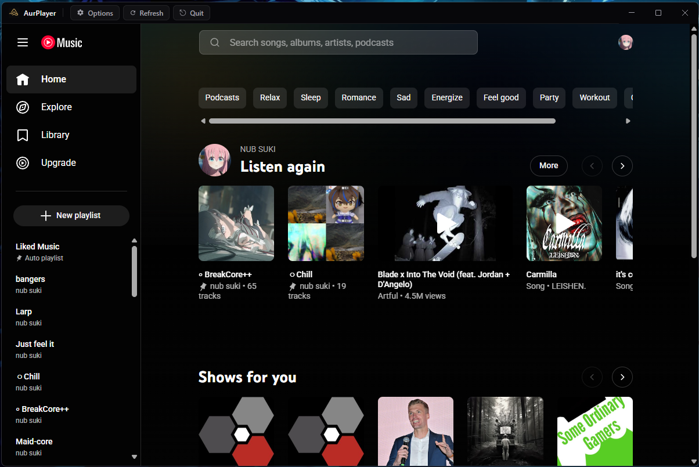
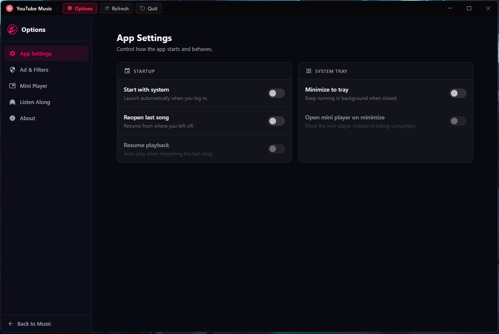
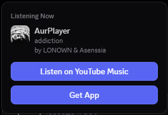
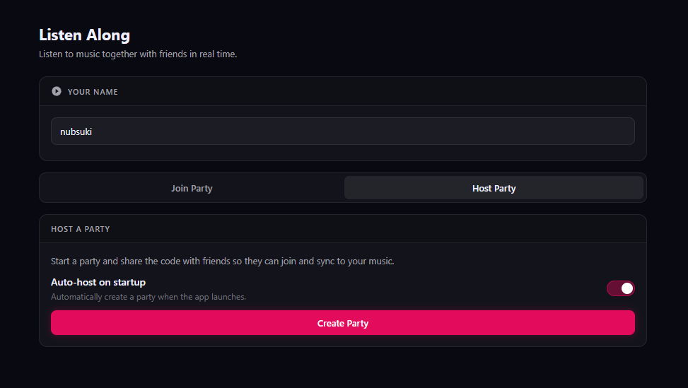
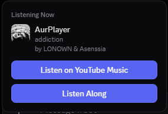

# AurPlayer

<div align="center">

A fast, clean, and feature-packed desktop client for **YouTube Music**.

[](https://github.com/nubsuki/AurPlayer/releases)
[](https://github.com/nubsuki/AurPlayer/releases)
[](https://github.com/nubsuki/AurPlayer/releases)
[](https://github.com/nubsuki/AurPlayer/releases)
[](LICENSE)
[](https://github.com/nubsuki/AurPlayer)
[](https://buymeacoffee.com/nubsuki)

<br/>



</div>

---

## Features

- **Modern Topbar & Navigation**: Sleek, minimalist topbar with a dedicated **Quit button** to safely exit the app regardless of tray minimization settings.
- **Settings Dashboard**: Tabbed interface to easily configure playback behavior, network filters, mini player themes, and Listen Along rooms.
- **Mini Player**: Compact, always-on-top mini player with seek bar, playback controls and **7 customizable themes**:
  - *Midnight* — Deep OLED black
  - *Blur* — Modern frosted glassmorphism
  - *Crimson* — Rich red accent
  - *Emerald* — Neon emerald green accent
  - *Violet* — Violet accent
  - *Nord* — Arctic cool blue accent
  - *Amber* — Warm golden amber accent
- **Listen Along (Beta)**: Synchronized real-time group listening with friends anywhere in the world via party codes, web view, and optional auto-hosting on startup. [Learn more](https://github.com/nubsuki/yt-music-sync-server) or check active parties at [ytms.nubsuki.xyz](https://ytms.nubsuki.xyz).
- **Discord Rich Presence**: Displays your current song, artist, album art, and Listen Along sync status in your Discord profile.
- **Filter Connection**: Network request filtering using customizable rule lists.
- **Custom Filter Lists**: Add, remove, and toggle custom request filter lists with persistent configuration and 24-hour auto-updates.
- **Auto-Continue Listening**: Automatically dismisses YouTube's "Still listening?" prompt to keep your music playing without interruption.
- **Remember Last Song & Resume Playback**: Reopens the last played track and restores playback to the exact second where you left off.
- **Cast Button Removal**: Automatically removes cluttering cast/connect buttons for a clean, distraction-free player.
- **Minimize to Tray**: Keep background music playing when minimized to the system tray.
- **Window Position Restore**: Remembers last window positions across sessions, with a quick tray option to reset them.
- **Multi-language Support**: Automatically detects system locale with support for English, Spanish, Italian, and Portuguese (translations by [@Rode1000](https://github.com/Rode1000)).
- **In-App Updates**: Check and install updates directly from the About tab.

---

## Keyboard Shortcuts

| Shortcut | Description |
| :--- | :--- |
| `Ctrl + H` | Hide / Minimize to tray (when minimize to tray is enabled) |
| `Ctrl + Q` | Quit application completely |
| `F12` / `Ctrl + Shift + I` | Toggle Developer Tools |

---

## Screenshots

### Settings Dashboard

<div align="center">
  
</div>

### Mini Player

<div align="center">
  
</div>

### Discord Rich Presence

<div align="center">
  
</div>

### Listen Along (Beta)

<div align="center">


| Hosting Room | Discord Presence |
| :---: | :---: |
|  |  |

</div>

---

## Get Started

### Windows
1. Visit the [Releases](https://github.com/nubsuki/AurPlayer/releases) page and download `AurPlayer-Setup.exe`.
2. Run the installer and launch the app from your Start Menu or Desktop.

### Linux
1. Ensure `fuse` is installed on your distribution.
2. Download the `.AppImage` or `.deb` package from the [Releases](https://github.com/nubsuki/AurPlayer/releases) page.


### macOS
> macOS builds are currently experimental and not code-signed with an Apple Developer certificate.
 Download the macOS [Releases](https://github.com/nubsuki/AurPlayer/releases).
- If macOS blocks the app (*"unidentified developer"* or *"app is damaged"*), right-click the app and choose **Open**, or run the following in Terminal:
  ```bash
  xattr -cr /Applications/"AurPlayer.app"
  ```


---

## Notes

> **Worried about account bans due to Ghostery / uBlock Origin core?**
Use a **burner account/email** or stick with **v1.4.0** that version doesn't include any uBlock Origin core or Ghostery functionality.

> **Upgrading from v1.4.0 or v1.5.0**:
> If upgrading from an older version, delete your legacy configuration folder to avoid compatibility issues:
> `%appdata% > Roaming > AurPlayer` (or legacy `youtube-music-player`)

---

## Disclaimer

This is an independent open-source project and is not affiliated with, endorsed by, or sponsored by YouTube, Google LLC, or Alphabet Inc. "YouTube" and the YouTube logo are registered trademarks of Google LLC.

---

## License

- This software is provided "as-is" without any warranties or guarantees.
- Licensed under the [Apache License 2.0](https://www.apache.org/licenses/LICENSE-2.0)
- Network filtering engines powered by [`@gorhill/ubo-core`](https://github.com/gorhill/uBlock) and [`@ghostery`](https://github.com/ghostery/adblocker)
